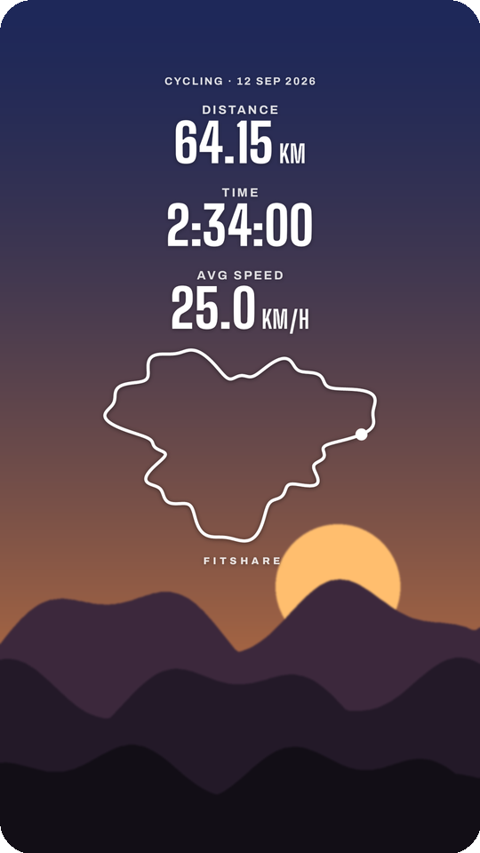
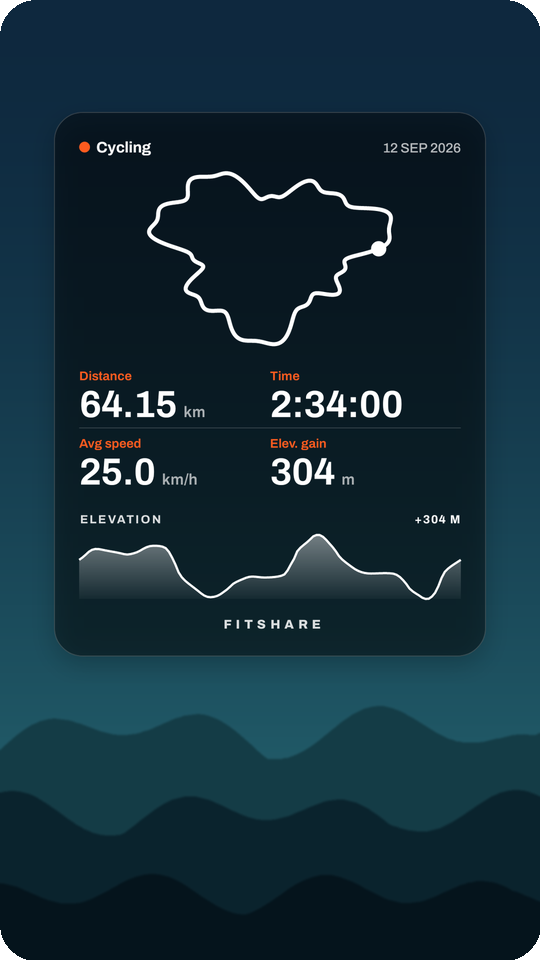
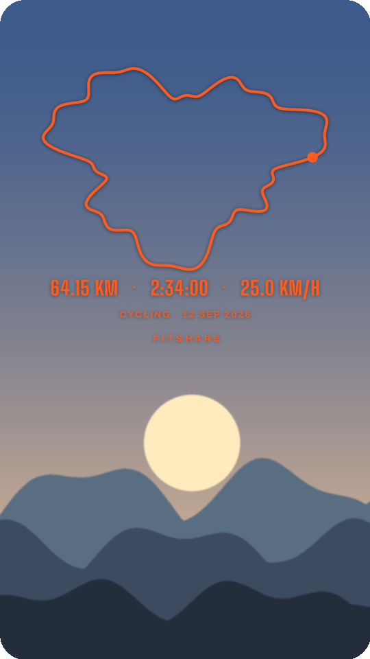
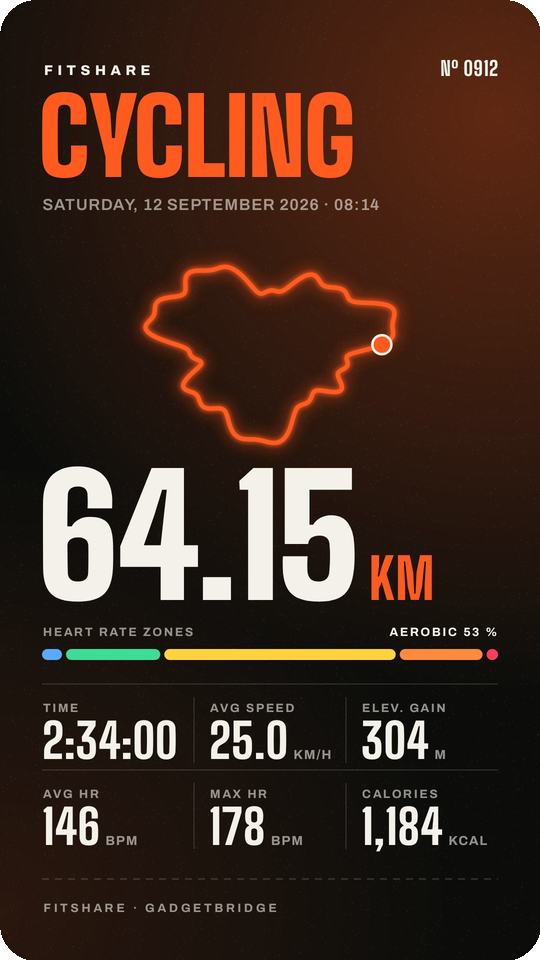
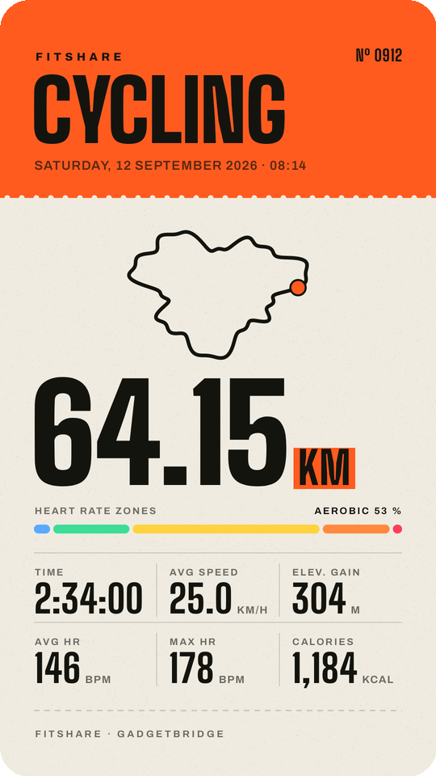
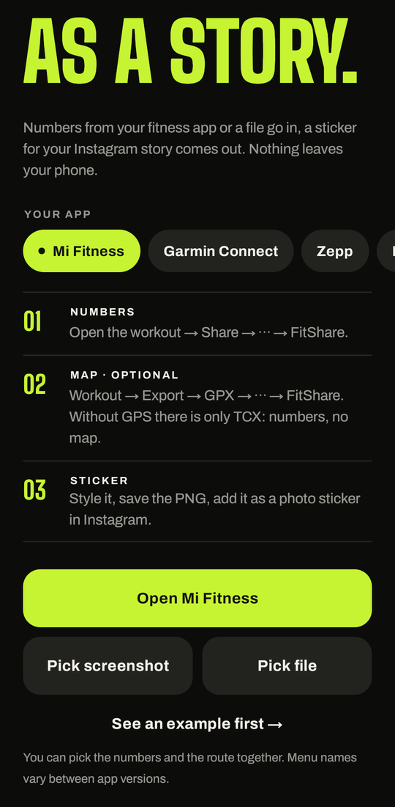
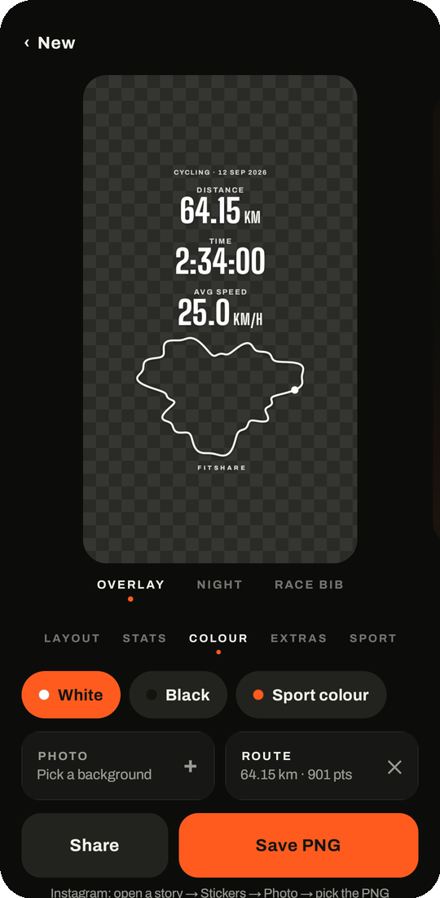

<h1 align="center">FitShare: Gadgetbridge workouts as Instagram story stickers</h1>

<p align="center"><strong>Android app that turns a Gadgetbridge workout export and a GPS route into a transparent PNG for your Instagram story, similar to Strava's stats sticker. Works offline, no account.</strong></p>

<p align="center">
  <a href="https://kotlinlang.org/"></a>
  <br>
  <a href="#install"></a>
  <a href="https://developer.android.com/compose"></a>
  <a href="https://gadgetbridge.org/"></a>
  <a href="#what-it-does"></a>
  <a href="#what-it-does"></a>
  <a href="#what-it-does"></a>
  <a href="LICENSE"></a>
  <a href="https://github.com/BrickyStudios/FitShare/releases/latest"></a>
  <a href="https://github.com/BrickyStudios/FitShare/commits/main"></a>
</p>

<p align="center">
  <a href="#install">Install</a> ·
  <a href="#how-to-use-it">How to use it</a> ·
  <a href="#build-it-yourself">Build it yourself</a> ·
  <a href="https://github.com/BrickyStudios/FitShare/releases">Releases</a>
</p>

Gadgetbridge records workouts from Mi Band, Amazfit and other watches without the vendor's cloud. It has no share button like Strava or Garmin Connect, and a Mi Band 10 export doesn't even contain the distance. FitShare reads the export, takes distance, elevation and the map from your GPX or KMZ route, and draws the image.

<p align="center">
  
  
  
</p>
<p align="center">
  
  
</p>

<p align="center"><sub>Demo data from an invented route. The backgrounds are drawn, in the app you use your own photo.</sub></p>

## What it does

**Overlay (transparent PNG).** Cropped to its content, so Instagram adds it as a sticker you can move and resize.

| Option | Choices |
|---|---|
| Layout | Stack (stats above the route, like Strava), Row, Card (translucent panel), Map (big route, one line of stats) |
| Stats | Any of distance, time, speed or pace, elevation gain, average and max heart rate, calories, steps, laps, SWOLF, strokes, stroke type. Tap order sets the order; "Auto" picks by sport |
| Colour | White, black, or the sport's colour |
| Extras | Route, elevation profile, heart rate zones, date, logo |
| Looks | Save the current setup under a name and put it on the next workout with one tap. Every saved or shared PNG also lands in a history of the last eight setups. Long-press a saved look to delete it |

The preview shows the overlay on your photo if you pick one. The saved PNG stays transparent.

**Full stories (1080 × 1920).** Two finished designs, Night and Race bib, for when you want the image as the whole story.

**Data.** Reads Gadgetbridge workouts as FIT or JSON, and routes as GPX, KML or KMZ (OpenTracks KMZ works as is). A FIT file also contains the sport, the heart rate zones and, if the watch or phone recorded GPS, the route. If the export lacks distance or time, FitShare computes them from the route, plus elevation gain. Without a sport in the file it guesses from the speed; you can change it.

**Everyday details.** Share the workout and the route to FitShare one after the other, or pick both at once. If Android closes the app while you are in Instagram, your workout, photo and settings are still there when you come back. The app follows your phone's language (English or German), or set it per app in Android 13+.

**Privacy.** No account, no network access, no analytics. Files stay on the phone.

## Install

Android 8.0 or newer. Download the APK from [Releases](https://github.com/BrickyStudios/FitShare/releases/latest), or add `https://github.com/BrickyStudios/FitShare` to [Obtainium](https://github.com/ImranR98/Obtainium) to get updates.

## How to use it

1. In Gadgetbridge, open the workout, tap ⋮ → **Share FIT File** and pick FitShare. (Share JSON Details works too.)
2. No GPS in the FIT? Share the route from OpenTracks as KMZ or GPX to FitShare as well, or tap **Choose files** and pick workout and route together.
3. Check the sport, then pick layout, stats, colour and extras.
4. Tap **Save PNG**. In Instagram, open a story, tap Stickers → Photo and pick the PNG.

<p align="center">
  
  
</p>

## Build it yourself

```bash
./gradlew testDebugUnitTest assembleRelease
```

Kotlin, Jetpack Compose, JDK 17. One Canvas renderer draws both the preview and the export, so what you save is what you saw. Without the signing secrets, release builds use the debug key. Fonts: [Big Shoulders Display](https://fonts.google.com/specimen/Big+Shoulders+Display) and [Archivo](https://fonts.google.com/specimen/Archivo), both under the SIL Open Font License (`app/src/main/assets/fonts`).

## License

[GPL-3.0](LICENSE), the same licence Gadgetbridge and OpenTracks use. You can use, change and share FitShare; if you distribute a changed version, publish its source under GPL-3.0 too. The bundled fonts keep their own SIL Open Font License.

FitShare is an independent project and is not affiliated with Gadgetbridge, Strava, Instagram or Meta.
