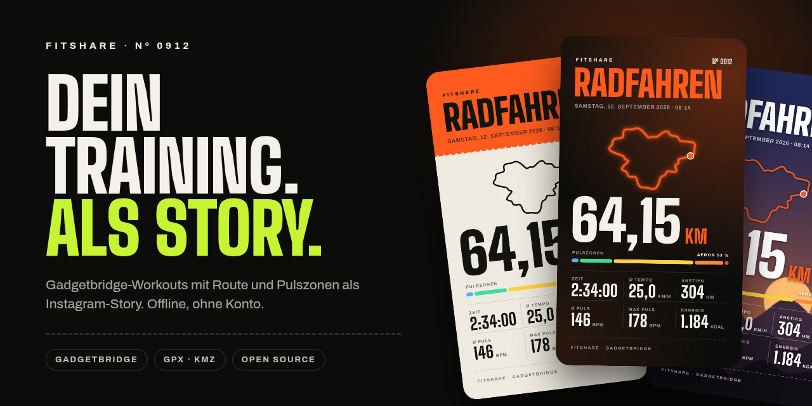
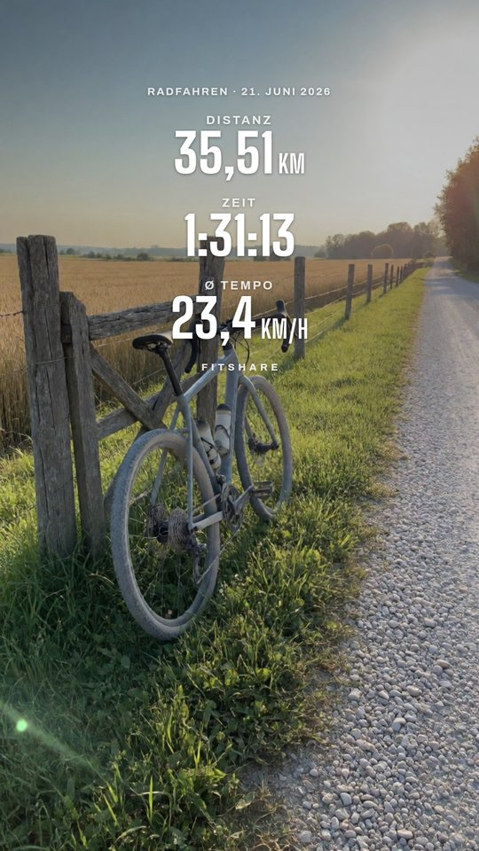
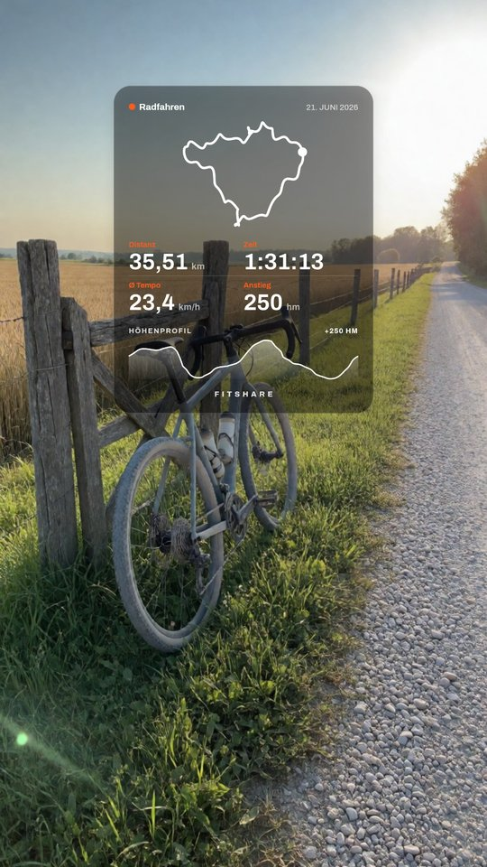
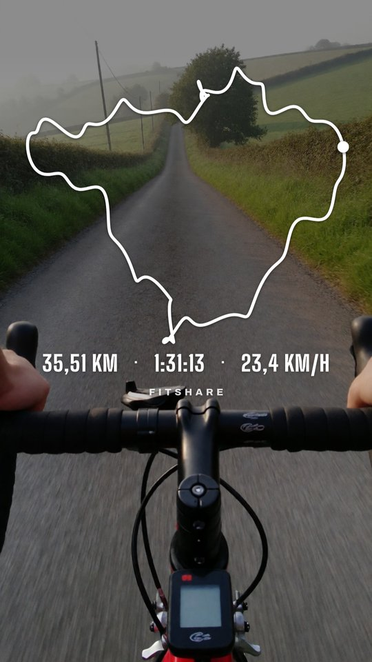
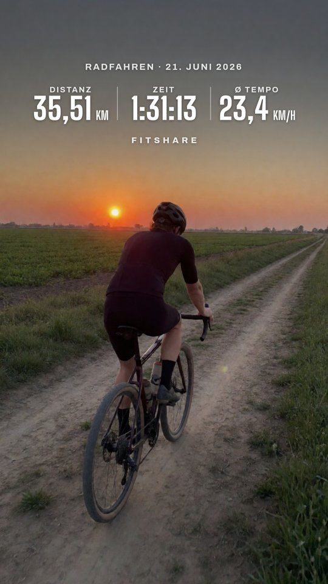
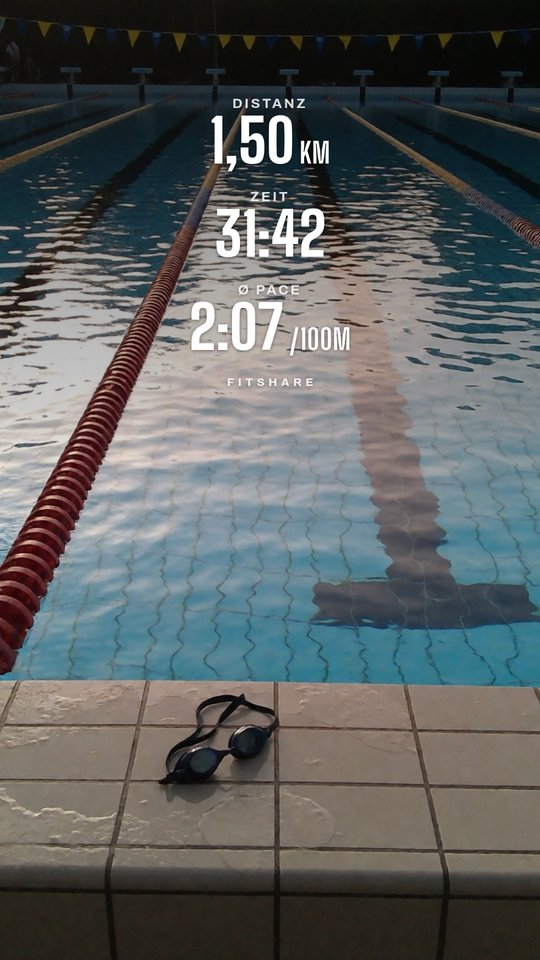
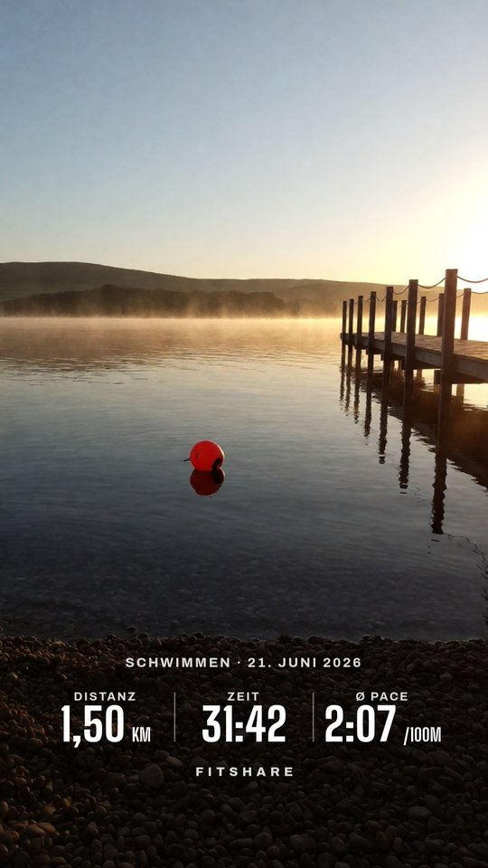

<p align="center"></p>

<h1 align="center">FitShare: Instagram story stickers from Mi Fitness, Garmin Connect, Gadgetbridge and other fitness apps</h1>

<p align="center"><strong>Android app and web app that turn a workout into a transparent PNG for your Instagram story, similar to Strava's stats sticker. Tap Share in Mi Fitness, Garmin Connect, Zepp, Huawei Health, Samsung Health or Strava, or hand it a GPX, TCX or Gadgetbridge FIT file. Works offline, no account, no subscription.</strong></p>

<p align="center">
  <a href="https://kotlinlang.org/"></a>
  <br>
  <a href="#install"></a>
  <a href="https://developer.android.com/compose"></a>
  <a href="https://gadgetbridge.org/"></a>
  <a href="#which-apps-work"></a>
  <a href="#what-it-does"></a>
  <a href="#what-it-does"></a>
  <a href="#what-it-does"></a>
  <a href="LICENSE"></a>
  <a href="https://github.com/BrickyStudios/FitShare/releases/latest"></a>
  <a href="https://github.com/BrickyStudios/FitShare/commits/main"></a>
</p>

<p align="center">
  <a href="https://github.com/BrickyStudios/FitShare/releases/latest/download/FitShare.apk"></a>
  <a href="https://brickystudios.github.io/FitShare/app/"></a>
</p>

<p align="center">
  <a href="#install">Install</a> ·
  <a href="#web-app-iphone-desktop">Web app</a> ·
  <a href="#how-to-use-it">How to use it</a> ·
  <a href="#which-apps-work">Which apps work</a> ·
  <a href="#build-it-yourself">Build it yourself</a> ·
  <a href="https://github.com/BrickyStudios/FitShare/releases">Releases</a> ·
  <a href="https://brickystudios.github.io/FitShare/">Website</a>
</p>

Fitness apps share a workout as a finished picture in their own design, and Strava and Garmin put some charts behind a subscription. FitShare shows up in their share sheet, reads the numbers off that picture on the phone, and lets you build your own sticker from them. Share the GPX or TCX as well and the route, elevation profile and km splits go on it too.

Gadgetbridge, which syncs Mi Band, Amazfit and other watches without the vendor's cloud, has no share button at all, and a Mi Band 10 export doesn't even contain the distance. FitShare reads its FIT or JSON export and takes distance, elevation and the map from your GPX or KMZ route.

<p align="center">
  
  
  
</p>
<p align="center">
  
  
  
</p>
<p align="center">
  
  
</p>

<p align="center"><sub>Demo data from an invented route. The photos are AI-generated stand-ins for your own; the stickers on them come straight out of the app (Photo tab, Photo in PNG).</sub></p>

## What it does

**Overlay (transparent PNG).** Cropped to its content, so Instagram adds it as a sticker you can move and resize.

| Option | Choices |
|---|---|
| Layout | Stack (stats above the route, like Strava), Row, Card (translucent panel), Map (big route, one line of stats) |
| Stats | Any of distance, time, speed or pace, elevation gain, average and max heart rate, calories, steps, laps, SWOLF, strokes, stroke type. Tap order sets the order; "Auto" picks by sport |
| Colour | White, black, or the sport's colour. **Darken** (off, light, medium, strong) puts a soft shade behind the numbers so they stay readable on bright photos; with black text it lightens instead |
| Photo | Shows up once you pick a photo. **Photo in PNG** bakes the photo into a finished 9:16 story, dimmed by the Darken setting. Then you can also set the position (top, middle, bottom), the size (S, M, L), a gradient that only darkens around the numbers, and a blur for the photo |
| Extras | Route, elevation profile, heart rate graph (from FIT), km splits as bars with the fastest km marked, heart rate zones, date, logo |
| Looks | Save the current setup under a name and put it on the next workout with one tap. Every saved or shared PNG also lands in a history of the last eight setups. Long-press a saved look to delete it |

The preview shows the overlay on your photo if you pick one. The saved PNG stays transparent unless you turn on Photo in PNG.

**Full stories.** Two finished designs, Night and Race bib, for when you want the image as the whole story (1080 × 1920) or as a feed post (4:5, 1080 × 1350).

**Data.** Reads the share picture of fitness apps (text recognition on the phone), Gadgetbridge workouts as FIT or JSON, and routes as GPX, TCX, KML or KMZ (OpenTracks KMZ works as is). From a picture FitShare gets distance, time, average and max heart rate, calories, elevation gain, steps and the sport, as far as the picture shows them. A FIT file also contains the sport, the heart rate zones and, if the watch or phone recorded GPS, the route. If the export lacks distance or time, FitShare computes them from the route, plus elevation gain. Without a sport in the file it guesses from the speed; you can change it.

**Everyday details.** Share the workout and the route to FitShare one after the other, or pick both at once. If Android closes the app while you are in Instagram, your workout, photo and settings are still there when you come back. The app follows your phone's language (English or German), or set it per app in Android 13+.

**Privacy.** No account, no network access, no analytics. Text recognition runs on the phone. Files stay on the phone.

## Install

Android 8.0 or newer. [Download FitShare.apk](https://github.com/BrickyStudios/FitShare/releases/latest/download/FitShare.apk) (always the latest version), or add `https://github.com/BrickyStudios/FitShare` to [Obtainium](https://github.com/ImranR98/Obtainium) to get updates.

iPhone, desktop or no APK: use the [web app](https://brickystudios.github.io/FitShare/app/) in the browser, see [below](#web-app-iphone-desktop).

## Web app (iPhone, desktop)

No Android, or you'd rather not install an APK? [brickystudios.github.io/FitShare/app](https://brickystudios.github.io/FitShare/app/) does the same in the browser: share pictures, GPX, TCX, FIT, KML, KMZ and Gadgetbridge JSON in, the same overlay layouts, Night and Race bib designs, looks and PNG export out.

- **iPhone:** in the fitness app, tap Share → Save Image, then pick the picture in the web app. Share → Add to Home Screen keeps it as an icon.
- **Android:** after "Install app" in Chrome, the web app shows up in the share sheet like the APK does.
- **Privacy:** text recognition ([Tesseract.js](https://github.com/naptha/tesseract.js), self-hosted in `docs/app/vendor`) runs in the browser. No uploads, no analytics, no third-party requests. The first picture loads about 8 MB of recognition data once.

The code is plain JavaScript in `docs/app`, a port of the Kotlin parser and renderer. `node --test tools/webapp_test.mjs` runs its tests.

## How to use it

1. Open FitShare and pick your fitness app at the top. The steps below it change to that app's menus. FitShare preselects the app you have installed, or the one that last shared into it, and **Open Mi Fitness** (or Garmin Connect, …) jumps straight there.
2. In your fitness app, open the workout, tap **Share** and pick FitShare. From Gadgetbridge: ⋮ → **Share FIT File**. No app at hand? **Pick screenshot** takes a picture from the gallery, **Pick file** takes FIT, TCX, GPX, KML, KMZ or JSON. **See an example first** opens the editor with an invented ride.
3. For the map, share the route as GPX, TCX or KMZ to FitShare as well, or pick workout and route together.
4. Check the sport, then pick layout, stats, colour and extras.
5. Tap **Save PNG**. In Instagram, open a story, tap Stickers → Photo and pick the PNG.

<p align="center">
  
  
</p>

## Which apps work

Any app whose Share button sends a picture of the workout. FitShare reads Latin script, so the app can be set to English, German, French, Spanish and similar languages.

| App | Watches | Share sends | File for the map |
|---|---|---|---|
| Mi Fitness | Xiaomi Smart Band, Redmi Watch | picture | workout → Export → GPX, KML or TCX → ⋯ → FitShare. Without GPS only TCX: numbers, no map |
| Zepp / Zepp Life | Amazfit | picture | GPX export in the workout (watches with GPS) |
| Garmin Connect | Forerunner, Venu, Fenix, Edge … | picture | GPX or TCX from the activity on connect.garmin.com |
| Huawei Health | Huawei Watch, Band | picture | route icon → Export route (GPX or TCX) |
| Samsung Health | Galaxy Watch | picture | Export as GPX file, at the bottom of the workout |
| Strava | any | picture | Export GPX on the activity at strava.com |
| Polar Flow | Polar | picture | GPX, TCX or FIT from Polar Flow on the web |
| COROS | COROS | picture | Export Data in the workout |
| Gadgetbridge | Mi Band, Amazfit, Garmin … | FIT or JSON | in the FIT if the watch has GPS, otherwise OpenTracks |

Menu names change between app versions. Numbers read from a picture can be wrong when the picture is cropped or busy; the files carry the exact values. More on the [website](https://brickystudios.github.io/FitShare/fitness-app-instagram-sticker/).

## Build it yourself

```bash
./gradlew testDebugUnitTest assembleRelease
```

Kotlin, Jetpack Compose, JDK 17. One Canvas renderer draws both the preview and the export, so what you save is what you saw. Without the signing secrets, release builds use the debug key. Share pictures are read with Google's [ML Kit text recognition](https://developers.google.com/ml-kit/vision/text-recognition/v2/android), bundled in the APK so it runs without Play Services (Huawei and degoogled phones). ML Kit is not open source. The INTERNET permission it asks for is removed in the manifest, so its usage statistics never leave the phone. Fonts: [Big Shoulders Display](https://fonts.google.com/specimen/Big+Shoulders+Display) and [Archivo](https://fonts.google.com/specimen/Archivo), both under the SIL Open Font License (`app/src/main/assets/fonts`).

## License

[GPL-3.0](LICENSE), the same licence Gadgetbridge and OpenTracks use. You can use, change and share FitShare; if you distribute a changed version, publish its source under GPL-3.0 too. The bundled fonts keep their own SIL Open Font License. As an additional permission under GPL-3.0 section 7, you may combine FitShare with Google ML Kit and distribute the result.

FitShare is an independent project and is not affiliated with Gadgetbridge, Xiaomi, Garmin, Zepp, Huawei, Samsung, Strava, Instagram or Meta.
