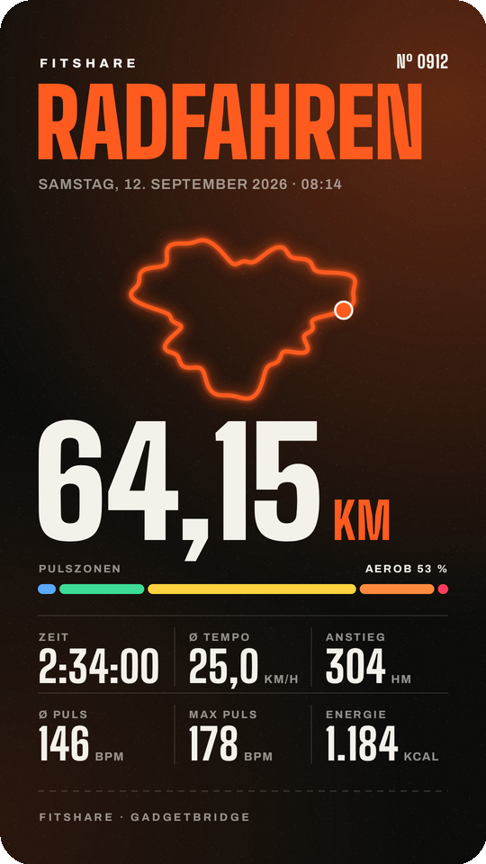
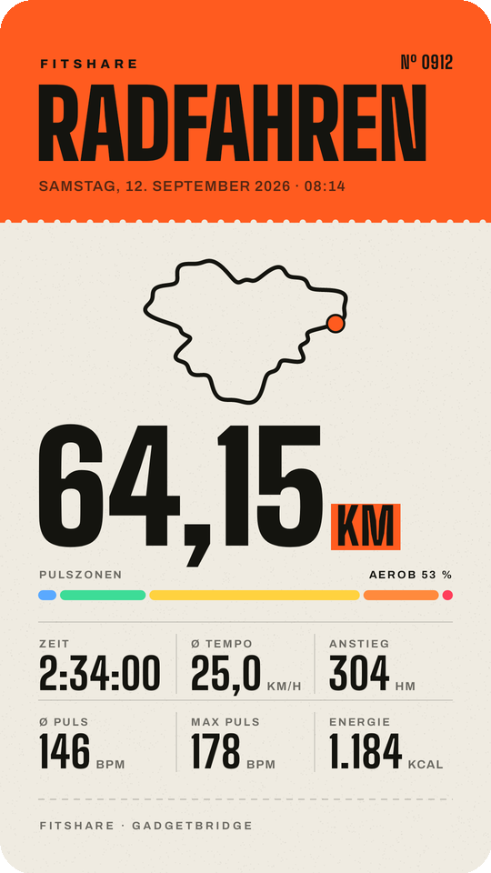
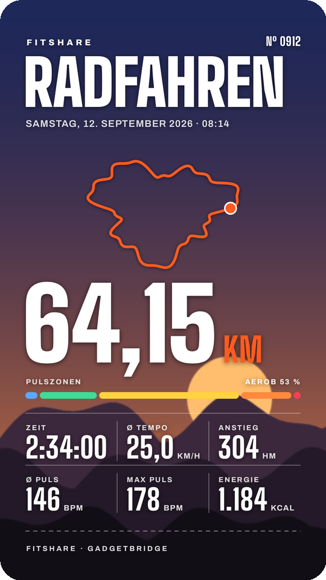

<h1 align="center">FitShare – Gadgetbridge-Workouts als Instagram-Story</h1>

<p align="center"><strong>Android-App, die aus deinem Gadgetbridge-Export und deiner GPS-Route eine fertige Instagram-Story (1080 × 1920) macht. Offline, ohne Konto.</strong></p>

<p align="center">
  <a href="https://kotlinlang.org/"></a>
  <br>
  <a href="#installation"></a>
  <a href="https://developer.android.com/compose"></a>
  <a href="https://gadgetbridge.org/"></a>
  <a href="#funktionen"></a>
  <a href="#funktionen"></a>
  <a href="https://github.com/BrickyStudios/FitShare/commits/main"></a>
  <a href="https://github.com/BrickyStudios/FitShare/stargazers"></a>
</p>

<p align="center">
  <a href="#installation">Installation</a> ·
  <a href="#so-gehts">So geht's</a> ·
  <a href="#selbst-bauen">Selbst bauen</a> ·
  <a href="https://github.com/BrickyStudios/FitShare/releases">Releases</a>
</p>

Gadgetbridge zeichnet Workouts von Mi Band, Amazfit und anderen Uhren ohne Hersteller-Cloud auf. Einen Teilen-Knopf wie bei Mi Fitness, Strava oder Garmin Connect hat es aber nicht. FitShare schließt die Lücke: Workout-JSON rein, Route dazu, Story teilen.

<p align="center">
  
  
  
</p>

<p align="center"><sub>Die Bilder zeigen eine erfundene Demo-Runde, keine echte Strecke.</sub></p>

## Funktionen

- 🎟️ **Drei Stile zum Durchwischen**: *Nacht* (dunkel, leuchtende Route), *Startnummer* (Papier mit Farbbalken wie eine Startnummer) und *Sticker* (transparentes PNG zum Drüberlegen in Instagram).
- 🗺️ **Route aus GPX, KML oder KMZ**: OpenTracks-Exporte funktionieren direkt. Fehlt im Gadgetbridge-Export die Distanz (beim Mi Band 10 üblich), rechnet FitShare sie aus der Route, dazu die Höhenmeter.
- 🚴 **Sportart erkannt oder gewählt**: Radfahren, Laufen, Schwimmen, Wandern oder Training. Jede Sportart hat eigene Kennzahlen und eine eigene Farbe.
- ❤️ **Pulszonen**: Die fünf Gadgetbridge-Zonen erscheinen als Balken.
- 🖼️ **Eigenes Foto** als Hintergrund.
- 📤 **Teilen oder speichern**: Teilen-Menü an Instagram und jede andere App, oder als PNG nach *Bilder/FitShare*.
- 💾 **Merkt sich alles**: Wechselst du zu Instagram und Android beendet FitShare im Hintergrund, ist beim Zurückkommen alles noch da, auch der zuletzt gewählte Stil.
- 🔒 **Offline**: keine Konten, kein Tracking, keine Server.

## Installation

Android 8.0 oder neuer. APKs baut der Workflow [Build & Release APK](.github/workflows/release.yml), sobald ein Tag `v*` gepusht wird. Sie landen unter [Releases](https://github.com/BrickyStudios/FitShare/releases) und lassen sich mit Obtainium verfolgen.

## So geht's

1. In Gadgetbridge die Aktivität öffnen und als JSON teilen oder exportieren. Optional die Route aus OpenTracks als KMZ oder GPX.
2. In FitShare **Dateien wählen** und beide auf einmal markieren. Alternativ beide nacheinander an FitShare teilen.
3. Stil wischen, Sportart antippen, Foto drunterlegen.
4. **In Story teilen** tippen und Instagram auswählen.

<p align="center">
  
  
</p>

## Selbst bauen

```bash
./gradlew testDebugUnitTest assembleRelease
```

Kotlin, Jetpack Compose, JDK 17. Vorschau und Export zeichnet derselbe Canvas-Renderer (`export/StoryRenderer.kt`), deshalb sieht die geteilte Story genau aus wie die Vorschau. Schriften: [Big Shoulders Display](https://fonts.google.com/specimen/Big+Shoulders+Display) und [Archivo](https://fonts.google.com/specimen/Archivo), beide unter der SIL Open Font License (`app/src/main/assets/fonts`).

## Hinweis

FitShare ist ein unabhängiges Projekt und gehört weder zu Gadgetbridge noch zu Instagram oder Meta.
